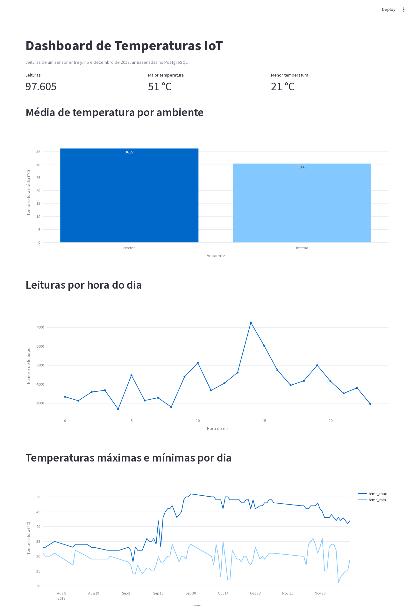

# Pipeline de Dados com IoT e Docker

Trabalho da disciplina Disruptive Architectures: IoT, Big Data e IA (UniFECAF).
Autor: Mikael Icaro Simões, RA 96278.
Vídeo pitch: https://youtu.be/9e-TnkabWEY

O projeto pega leituras de temperatura de um sensor IoT, grava num banco PostgreSQL que roda em container e mostra os dados num dashboard feito com Streamlit.



## Tecnologias

- Python 3, com pandas e SQLAlchemy para ler e gravar os dados
- PostgreSQL 16 em container (Docker ou Podman)
- Streamlit e Plotly para o dashboard
- Git e GitHub para versionamento

## Os dados

Dataset "Temperature Readings: IoT Devices", do Kaggle:
https://www.kaggle.com/datasets/atulanandjha/temperature-readings-iot-devices

O arquivo `IOT-temp.csv` já está na pasta `data/`, então não precisa baixar de novo. Ele tem 97.606 leituras de um sensor, entre 28/07/2018 e 08/12/2018, com estas colunas:

| Coluna no CSV | Coluna no banco | O que é |
|---|---|---|
| `id` | `id` | identificador da leitura |
| `room_id/id` | `device_id` | dispositivo que leu (só existe um: "Room Admin") |
| `noted_date` | `noted_at` | data e hora da leitura |
| `temp` | `temperature` | temperatura em °C |
| `out/in` | `ambiente` | `interno` ou `externo` |

Um `id` aparece duas vezes no arquivo. O script de carga mantém só a primeira ocorrência, então o banco fica com 97.605 linhas.

## Estrutura

```
.
├── data/IOT-temp.csv       dataset original
├── docs/                   print do dashboard e relatório
├── sql/views.sql           as 3 views
├── src/
│   ├── config.py           caminhos e conexão com o banco
│   ├── carga.py            lê o CSV e grava no PostgreSQL
│   └── dashboard.py        dashboard Streamlit
├── docker-compose.yml      container do PostgreSQL
└── requirements.txt
```

## Como executar

Pré-requisitos: Python 3.10 ou mais novo, Git, e Docker ou Podman.

1. Baixar o projeto

```bash
git clone https://github.com/Mikael-Icaro/Disruptive-Architectures-unifecaf.git
cd Disruptive-Architectures-unifecaf
```

2. Criar o ambiente virtual e instalar as dependências

```bash
python3 -m venv .venv
source .venv/bin/activate
pip install -r requirements.txt
```

3. Subir o PostgreSQL

```bash
docker compose up -d
```

Isso cria o container `postgres-iot` com usuário `iot`, banco `iot` e senha `iot_senha`, aceitando conexão só em `127.0.0.1:5432`. Para trocar a senha, defina `POSTGRES_PASSWORD` antes de subir e `DATABASE_URL` antes de rodar os scripts.

Para conferir que o banco está de pé:

```bash
docker exec postgres-iot pg_isready -U iot
```

4. Carregar os dados

```bash
python src/carga.py
```

Saída esperada:

```
1 linha(s) duplicada(s) removida(s)
97605 leituras gravadas e views criadas
```

5. Abrir o dashboard

```bash
streamlit run src/dashboard.py
```

O navegador abre em http://127.0.0.1:8501.

6. Encerrar

```bash
docker compose down
```

Os dados ficam guardados no volume `pgdata`. Para apagar tudo, incluindo o volume, use `docker compose down -v`.

Em Fedora com Podman o `docker compose` funciona pelo `podman-compose`. O arquivo usa o nome completo da imagem (`docker.io/library/postgres:16`) porque o Podman não aceita nome curto sem terminal interativo.

## As views SQL

Estão em `sql/views.sql` e são recriadas toda vez que a carga roda.

**`avg_temp_por_dispositivo`**: média de temperatura e total de leituras por dispositivo e ambiente. Como o dataset tem um único dispositivo, separar por ambiente é o que dá comparação útil: a média interna fica em 30,45 °C e a externa em 36,27 °C. Alimenta o gráfico de barras.

**`leituras_por_hora`**: quantas leituras o sensor registrou em cada hora do dia (0 a 23). Serve para ver quando o sensor trabalha mais e para checar se há horários sem cobertura. Alimenta o gráfico de linha de leituras por hora.

**`temp_max_min_por_dia`**: temperatura máxima, mínima e média de cada dia. Mostra a variação ao longo dos meses. Alimenta o gráfico de máximas e mínimas.

## O que os dados mostram

- O sensor externo faz bem mais leituras (77.260 contra 20.345) e varia mais: o desvio padrão é 5,7 °C no externo e 2,2 °C no interno.
- O horário com mais leituras é 14h (7.248), seguido de 15h (6.029). O de menos é 4h (2.690).
- A maior temperatura registrada foi 51 °C, em 30/09/2018. A menor foi 21 °C, em 03/12/2018.
- O volume de dados é muito desigual entre os meses: 154 leituras em julho, 2.241 em agosto e 42.740 em setembro. Por isso a máxima diária parecer subir em setembro pode ser, em parte, só mais cobertura do sensor, e não um aquecimento real.
- Há dias sem nenhuma leitura. A maior lacuna fica entre 05/11 e 17/11: nenhuma leitura de 06/11 a 16/11, 11 dias seguidos. Em um uso real isso apontaria falha de coleta ou sensor offline.

## Comandos Git utilizados

```bash
git init
git add .
git commit -m "Projeto inicial: Pipeline de Dados IoT"
git remote add origin git@github.com:Mikael-Icaro/Disruptive-Architectures-unifecaf.git
git push -u origin main
```

Para atualizar depois: `git add .`, `git commit -m "mensagem"` e `git push`. Para trazer mudanças do remoto: `git pull`.
